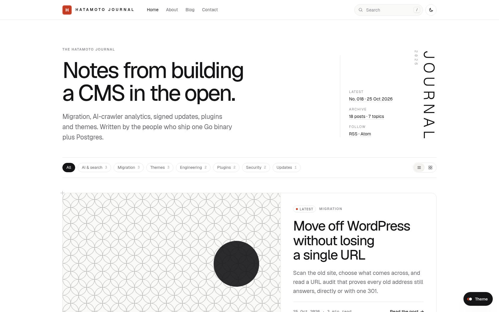

# Hanshi

A blog theme for [Hatamoto](https://hatamoto.dev). Hairline frames, generated pattern
covers, a page ruler for pagination and an index that follows you through every post.



- **Homepage** with the latest posts: one lead post and a numbered index, paged at
  `/?page=N` (5 per page by default), a topic bar and a topics grid.
- **Pagination ruler** on every listing: one segment per page, a numbered pager with
  gaps, Newer and Older links, a "go to page" box and `←` `→` keys.
- **Posts** with an index sidebar built from the headings (scroll spy, reading progress,
  minutes left, copy-section link), numbered headings, a mobile index bar, the author
  box, tags and related posts.
- **Archive, topic, author and search pages** grouped by month, with the same ruler.
- **Generated covers**: a post without a featured image gets one of seven traditional
  line patterns, chosen from its category, so the same post always looks the same.
- **Search palette** on `/` or `⌘K`, filled from `/feed.xml`, with a plain `/search`
  form when JavaScript is off.
- **Design tokens**: every value is a `--hm-*` token, so **Theme > Colours and fonts**
  and **Theme > Design system** restyle it. The theme opts in to `builder.tokens` and to
  the `header`, `footer`, `single` and `archive` layout parts.
- **Light and dark** with the engine's own toggle.

Everything works without JavaScript. The scripts only add the covers, the palette, the
post index and the keyboard shortcuts. They are served from the site itself, so the
theme runs under the strict public script policy (`csp.strictScripts`). Nothing loads
from another host.

## Install

From the registry: **Theme > Themes > Available themes**, then **Install**, **Preview**
and **Activate**.

From a terminal on the server:

```sh
hatamoto package install hanshi-1.0.0.hmp
hatamoto theme activate hanshi
```

Hanshi ships only the blog layouts and its stylesheet. Pages, sections and forms come
from the built-in theme through the lookup chain, so sites built with sections keep
working.

## Settings

**Theme > Themes > Hanshi > Settings**:

| Setting | Default | What it does |
| --- | --- | --- |
| Accent colour | `brand` | `brand` uses the colour from Colours and fonts; `indigo`, `moss` and `ink` are presets with a dark-mode pair |
| Heading font | `sans` | `serif` switches headings to a book serif |
| Spacing | `comfortable` | `compact` scales the spacing tokens down |
| Corners | `soft` | `sharp` uses near-square corners |
| Colour mode | `light` | what a first visit shows: `light`, `dark` or `auto` (follows the system); visitors can still switch |
| Posts per homepage page | `5` | 1 to 12 |
| Homepage list | `list` | `list` or `grid`; visitors can switch, saved in their browser |
| Show the homepage's own sections | off | render the sections of the page set as the homepage below the posts |
| Address of the post archive | `/blog` | where "All" and "Full archive" point |
| Masthead label, headline, text | `The journal`, site name, site tagline | the homepage masthead |
| Vertical masthead word | `Journal` | empty hides it |
| Covers | `auto` | `image-only` turns the generated covers off |
| Post index sidebar | on | shown when a post has two or more headings |
| Newsletter address | empty | adds an Email link and a Subscribe button |
| Let visitors try the presets | off | a small Theme panel for demo sites |

## Notes

- Listing cards show a topic when the post has a `category` attribute. Category terms
  appear on the post itself, its breadcrumb and the topic pages.
- The post index needs `h2` and `h3` headings in the post body. Their ids come from the
  engine's `docBody` function.

## Develop

You need a Hatamoto binary and a development site (any `ENVIRONMENT` other than
`production`).

```sh
export DATABASE_URL=postgres://...      # a local, throwaway database
hatamoto serve &                         # the site
python3 dev/seed.py                      # an owner, 16 posts with bodies, 7 categories
hatamoto theme dev . --dev               # push on every save
node dev/smoke.mjs http://127.0.0.1:8080 # browser checks (needs playwright-core and Chrome)
hatamoto theme check . --registry --expect-name hanshi
```

`dev/` is not part of the package. The package holds `theme.json`, `layouts/`,
`partials/`, `assets/`, `README.md`, `LICENSE` and `CHANGELOG.md`.

## License

Apache-2.0, see [LICENSE](LICENSE). The Geist fonts come from the built-in theme
(SIL Open Font License 1.1).
